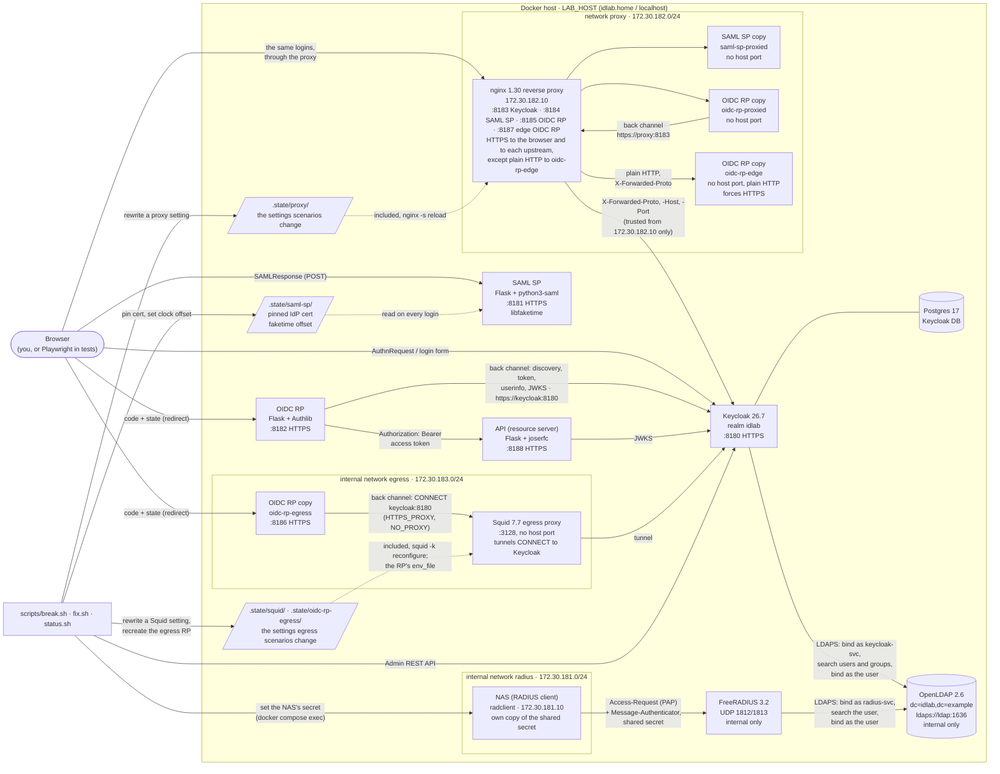

# identity-lab

[](https://codespaces.new/MarkHawk/identity-lab?quickstart=1)

A self-contained identity lab you can break on purpose. A Keycloak identity provider, an OpenLDAP directory it federates users from, two sample apps (one SAML, one OIDC), an nginx reverse proxy in front of Keycloak and a second copy of each app, a Squid egress proxy that a third copy of the OIDC app must use to reach Keycloak, and a FreeRADIUS server with a NAS that authenticates the same directory users, all run in Docker Compose. One-command scenarios reproduce real single sign-on and network login failures, and each scenario has a support-style runbook for diagnosing and fixing it.

**[Walkthrough: from ticket to fix, with every tool](docs/walkthrough.md)** follows support tickets from the first message to the fix: an expired SAML signing certificate, then an egress proxy outage after a network change, with identity-lab, token-inspector, identity-support-splunk and rate-limit-probe.

## The problem this solves

When enterprise SSO breaks, the support engineer usually sees only the customer's description: *"SSO stopped working for everyone"*. The cause is buried in signed XML, token claims, certificates, clocks and two sets of logs owned by different teams.

This lab makes those failures **reproducible and safe to practise on**:

- **Break it:** `scripts/break.sh <scenario>` puts the lab into a realistic failure, such as:
  - an expired IdP certificate, a skewed clock or a mismatched redirect URI
  - a failing LDAP bind or a RADIUS shared secret mismatch
  - a reverse proxy returning 502 Bad Gateway, 504 Gateway Time-out or 429 Too Many Requests, sending Keycloak the wrong X-Forwarded headers, or with a header buffer too small for Keycloak's cookies
  - an egress (forward) proxy between an app and the IdP that suddenly requires a login (407), blocks the IdP by policy (403) or intercepts TLS with a CA the app doesn't trust, or an app whose `NO_PROXY` sends its IdP calls around the proxy
- **See it as the customer does:** the apps, Keycloak and the proxies show the exact error a user would see. Their debug pages show the decoded SAML assertion or ID token. The NAS shows what a switch or VPN gateway would: Access-Accept, Access-Reject or no reply.
- **Diagnose it as support would:** every scenario has a runbook covering the symptom, where to look, diagnosis, fix, prevention, and the questions to ask the customer.
- **Prove it:** `scripts/test.sh` runs a real headless-browser login against each app, directly and through the proxies, and a RADIUS login from the NAS, breaks every scenario, asserts the user-facing error and the log evidence, fixes it, and asserts recovery. CI runs the same script.

## Architecture



- **Front channel:** browsers reach everything at `https://$LAB_HOST:818x`. Keycloak issues tokens with the issuer for the port they used: `:8180` directly, `:8183` through the proxy.
- **Reverse proxy:** nginx publishes Keycloak and a second copy of each app on 8183–8185, so the whole login can go through it, as it would behind a real load balancer or ingress. It verifies each upstream's TLS certificate against the lab CA. It tells Keycloak the scheme and port the browser used in `X-Forwarded-*` headers, which Keycloak trusts only from the proxy's fixed address. The copies behind it have no host port of their own, and the proxied OIDC RP's back channel goes through the proxy too.
- **Egress proxy:** a third copy of the OIDC RP, `oidc-rp-egress` on `:8186`, sits on an internal network whose only way out is Squid, like an app server that must use a corporate forward proxy. Its back channel (discovery, token, userinfo, JWKS) goes to Squid as `CONNECT keycloak:8180`, set by `HTTPS_PROXY` and `NO_PROXY`, and Squid tunnels it. The browser side of its login doesn't use the proxy: the browser reaches the app on `:8186` and Keycloak directly on `:8180`. Squid publishes no host port.
- **Edge RP:** a fourth copy of the OIDC RP, `oidc-rp-edge`, sits behind the reverse proxy on `:8187` with TLS ending at the proxy and plain HTTP behind it, as behind most load balancers. It learns that the browser used HTTPS only from `X-Forwarded-Proto` (trusting one proxy hop), and redirects anything that looks like plain HTTP to its `https://` URL.
- **API:** a resource server on `:8188` that accepts Keycloak access tokens. The direct OIDC RP calls it with the user's access token (**Call the API** on its debug page). It checks the token offline: the signature against Keycloak's JWKS, the issuer, the expiry and that `aud` includes `idlab-api`, which an audience mapper on the `oidc-rp` client adds. A failure gets a 401 with an RFC 6750 `WWW-Authenticate` header saying why.
- **Back channel:** the OIDC RP talks to Keycloak directly over the compose network at `https://keycloak:8180`, rewriting the token, userinfo and JWKS endpoints from discovery to that address (`OIDC_BACKCHANNEL_BASE`). The same images therefore work with `LAB_HOST=idlab.home` on a LAN and `LAB_HOST=localhost` in CI.
- **Directory:** Keycloak federates users from OpenLDAP (read only, imported on first login). It binds as a dedicated read-only service account, `cn=keycloak-svc`, to find users and their groups, then binds as the user to check the password. The directory has no host port; it's reachable only on the compose network.
- **RADIUS:** the NAS stands in for a switch, wireless controller or VPN gateway. It sends PAP Access-Requests to FreeRADIUS, which finds the user in the directory as its own read-only account, `cn=radius-svc`, and checks the password by binding as the user. So dave, erin and frank can log in over RADIUS as well as through Keycloak. RADIUS publishes no host port. The NAS sits on an internal network with a fixed IP, because the server identifies clients by source address.
- **SP trust:** the SAML SP doesn't fetch IdP metadata. Like most SaaS service providers, it trusts the IdP certificate pinned at onboarding (`scripts/pin-idp-cert.sh`).

## Quick start

**Prerequisites:** Linux with Docker Engine and Compose v2, plus `bash`, `openssl`, `curl` and `jq`. It uses host ports 8180–8188.

```bash
git clone https://github.com/MarkHawk/identity-lab && cd identity-lab

scripts/setup.sh                 # CA, certificates and random secrets -> .env and certs/ (prints no secrets)
                                 # set LAB_HOST=localhost first if you have no DNS name for this machine
docker compose up -d --wait      # Keycloak + Postgres + OpenLDAP + FreeRADIUS + NAS + the apps + the API + both proxies (first build takes 10 minutes or more: Squid is compiled from source)
scripts/pin-idp-cert.sh          # "onboard" the SAML SP: trust the IdP's current signing certificate
scripts/status.sh                # service health and the live state of every scenario
docker compose exec nas nas-auth dave   # a RADIUS login from the NAS; enter the demo password -> "nas: Access-Accept"
```

### Open the apps: HTTPS only

Use a browser on a machine that resolves `LAB_HOST` to the lab host. **Every URL is `https://`.** There is no plain-HTTP listener and no redirect, so `http://` URLs fail with `ERR_EMPTY_RESPONSE` (see [Troubleshooting](#troubleshooting)).

| Service | URL |
|---|---|
| Keycloak (IdP); admin console at `/admin/` | **https://idlab.home:8180** |
| SAML service provider | **https://idlab.home:8181** |
| OIDC relying party | **https://idlab.home:8182** |
| Keycloak through the reverse proxy | **https://idlab.home:8183** |
| SAML service provider through the reverse proxy | **https://idlab.home:8184** |
| OIDC relying party through the reverse proxy | **https://idlab.home:8185** |
| OIDC relying party whose calls to Keycloak go through the egress proxy | **https://idlab.home:8186** |
| OIDC relying party behind the reverse proxy, plain HTTP behind it | **https://idlab.home:8187** |
| API (resource server); called by the OIDC RP on `:8182` | **https://idlab.home:8188** |

If you set a different `LAB_HOST`, use that instead of `idlab.home`.

Sign in to the apps as one of the [demo users](#demo-users). The Keycloak admin console user is `admin`. To see its password on your own screen, run `grep '^KC_ADMIN_PASSWORD=' .env | cut -d= -f2`.

#### The certificate warning is expected

The first time you open each URL, the browser warns *"Your connection is not private"* (`NET::ERR_CERT_AUTHORITY_INVALID` in Chrome and Edge). That's because `setup.sh` created the lab's **own certificate authority**, and your browser has never heard of it. For a lab, it's fine to click **Advanced → Continue/Proceed**.

Accept the warning on each URL you'll use (all seven, if you try both proxies) **before** you first log in. Otherwise the hand-off from Keycloak back to an app can stop at a warning page. If that happens, accept it and start the login again. Private/incognito windows ask again.

#### Don't install the lab CA as trusted on your computer

You could make the warnings go away by importing `certs/ca.crt` into your operating system's or browser's trusted root store. **Don't**, especially on a machine you use for anything else:

- **The CA is not limited to the lab.** It can sign certificates for *any* hostname: your bank, your email, your company's SSO.
- **Its private key isn't protected like a real CA's.** `certs/ca.key` sits unencrypted on the lab server, readable by anyone who gets that user account, a backup or a copy of the repo directory.
- **Together, that means interception.** Anyone with the key could issue certificates your computer would accept silently, and intercept HTTPS traffic without a single warning. Trusting a root on Windows applies system-wide (Edge, Chrome and other apps), not just to this lab.

Clicking through the warning gives exactly the same lab experience without that risk. The automated tests do trust the CA, but only inside a throwaway browser container that's deleted after each run.

If you imported it earlier, remove it:

- **Windows:** `certmgr.msc` → *Trusted Root Certification Authorities* → *Certificates* → delete **identity-lab Local CA**.
- **macOS:** Keychain Access → delete it from the *System* or *login* keychain.

### Demo users

| User | Email | Lab roles | Use it for |
|---|---|---|---|
| `alice` | alice@idlab.example | `lab-user`, `lab-admin` | The default user: the walkthrough and the automated tests sign in as alice. She has every lab role, so the `role` attribute and `realm_roles` claim are fully populated. |
| `bob` | bob@idlab.example | `lab-user` | An ordinary user. Compare his debug pages with alice's to see how a role difference shows up in the SAML assertion and the ID token. |
| `carol` | carol@idlab.example | *none* | Signed in but not authorised. Logging in succeeds because authentication only proves who she is. The sample apps don't enforce roles, so carol gets in; a real app would check `role` / `realm_roles` and refuse her. |
| `dave` | dave@idlab.example | `lab-user` (LDAP group) | **From LDAP.** The automated tests use dave for the directory logins, the RADIUS logins, and the `ldap-bind-failure` and `radius-shared-secret-mismatch` scenarios. |
| `erin` | erin@idlab.example | `lab-user`, `lab-admin` (LDAP groups) | From LDAP, with every lab role, like alice. |
| `frank` | frank@idlab.example | *none* | From LDAP, in no group, like carol. |

alice, bob and carol live in Keycloak's own database. dave, erin and frank live in the directory under `ou=people,dc=idlab,dc=example`. Keycloak imports each one on their first login, and maps their LDAP groups (`ou=groups`) to the realm roles of the same name. So the claims look the same whichever kind of user signs in. In the admin console, federated users show a *Federation link* to `idlab-ldap`.

Over RADIUS, only the directory users can log in: FreeRADIUS reads the directory, not Keycloak, so alice, bob and carol get Access-Reject from the NAS.

Every user also carries Keycloak's default roles (`default-roles-idlab`, `offline_access`, `uma_authorization`), and these show up in the claims too. In SAML, the `role` attribute also includes the built-in `account` client's roles (`view-profile`, `manage-account`, …). The OIDC `realm_roles` claim has realm roles only.

**Password:** all six share `DEMO_PASSWORD`, which `setup.sh` generates at random into `.env`. It isn't written anywhere else. To see it on your own screen, run this on the lab host:

```bash
grep '^DEMO_PASSWORD=' .env | cut -d= -f2
```

Don't paste it into tickets, chats or screenshots. If it does leak, [rotate the secrets](#rotating-secrets).

### Break something

```bash
scripts/break.sh clock-skew      # now try the SAML login
scripts/status.sh                # clock-skew  broken  saml-sp clock is +600s vs host ...
scripts/fix.sh clock-skew        # or: scripts/fix.sh --all

scripts/break.sh radius-shared-secret-mismatch
docker compose exec nas nas-auth dave   # nas: no reply from radius:1812 after 3 attempts (6s): RADIUS server not responding
scripts/fix.sh radius-shared-secret-mismatch

scripts/break.sh proxy-rate-limit       # now log in at https://idlab.home:8185: 429 Too Many Requests
docker compose logs proxy | grep 'limiting requests'
scripts/fix.sh proxy-rate-limit

scripts/break.sh proxy-tls-interception # now log in at https://idlab.home:8186: certificate verify failed
docker compose logs squid | grep TLS_LIB_ERR
scripts/fix.sh proxy-tls-interception

scripts/break.sh api-bearer-audience    # log in at https://idlab.home:8182, then "Call the API": 401 invalid_token
docker compose logs api | grep api_token_rejected
scripts/fix.sh api-bearer-audience
```

## Run it in Codespaces

No local setup: GitHub Codespaces runs the whole lab in a cloud container you drive from your browser. New to Codespaces? Follow the [step-by-step guide](docs/codespaces.md).

1. Click **Open in GitHub Codespaces** at the top of this page, then **Create codespace**. It picks a **2-core, 8 GB** machine, the smallest size: the whole lab, both proxies included, uses about 1.2 GB once running.
2. Wait for the terminal to show `setup complete for https://localhost:8180`. Creating the codespace takes a few minutes; `scripts/setup.sh` itself takes a few seconds. Secrets and certificates are generated inside your codespace and never committed.
3. In the terminal, build the lab and prove it works. The first run takes about 20 minutes because it builds every image, including a Chromium test image and Squid, which is compiled from source:

   ```bash
   scripts/test.sh --fresh
   ```

4. Try a scenario:

   ```bash
   scripts/break.sh radius-shared-secret-mismatch
   docker compose exec nas nas-auth dave   # paste the demo password: grep '^DEMO_PASSWORD=' .env | cut -d= -f2
   scripts/status.sh                       # radius-shared-secret-mismatch  broken
   scripts/fix.sh radius-shared-secret-mismatch
   ```

   Any scenario from the [table](#scenarios) works the same way, and `scripts/test.sh` checks each one's browser error and log evidence for you.

**Browser logins aren't supported in the codespace's own forwarded URLs.** The Ports tab lists 8180 (Keycloak), 8181 (SAML SP), 8182 (OIDC RP), the reverse proxy's 8183 to 8185, the egress proxy's OIDC RP on 8186, the edge OIDC RP on 8187 and the API on 8188, but Codespaces gives each port its own hostname, `https://<codespace>-8181.app.github.dev` with no port number. The lab's issuer, SAML entity IDs and redirect URIs are all `https://LAB_HOST:<port>` (in a codespace, `https://localhost:8181` and so on), so a login started there is sent back to `localhost` and fails. Making the lab follow per-port hostnames would mean a different URL scheme from the one you'd see locally and in CI, so it doesn't. Use desktop VS Code (below) to log in yourself, or `scripts/test.sh`: it runs real Chromium logins inside the codespace and saves screenshots and page HTML to `test-results/`.

**Clicking through the apps yourself: open the codespace in desktop VS Code.** With the GitHub Codespaces extension installed, use [github.com/codespaces](https://github.com/codespaces) > **...** > **Open in** > **Visual Studio Code**. VS Code forwards ports 8180 to 8188 to your own `localhost` on the same numbers, so `https://localhost:8181/` and the other [lab URLs](#open-the-apps-https-only), with `localhost` in place of `idlab.home`, work in your own browser. [docs/codespaces.md](docs/codespaces.md) is a step-by-step guide for first-time Codespaces users.

**Codespaces uses your own GitHub allowance.** Personal accounts get a free monthly quota of core hours and storage; a 2-core machine uses two core hours for every hour it runs. Stop the codespace when you're done (it also stops itself when idle), and delete it from [github.com/codespaces](https://github.com/codespaces) to free its storage. See GitHub's [Codespaces billing documentation](https://docs.github.com/en/billing/managing-billing-for-your-products/managing-billing-for-github-codespaces/about-billing-for-github-codespaces) for the current quotas.

## Try it in 10 minutes

Start with the lab up, the IdP certificate pinned, and `scripts/status.sh` showing every scenario **healthy**. Use one **normal** browser window for steps 1–3, because single sign-on needs the same browser session. Step 4 uses a private window.

**1. OIDC as alice (≈3 min)**

1. Open **https://idlab.home:8182** and click **Log in with OIDC**.
2. You're sent to Keycloak at `:8180`, realm *Identity Lab*. Sign in as `alice` with the [demo password](#demo-users).
3. You land on **OIDC login succeeded**. Look at:

| Claim | What it tells you |
|---|---|
| `iss` | `https://idlab.home:8180/realms/idlab`, the issuer. The RP rejects tokens from anyone else, so a hostname or realm mismatch here is a classic failure. |
| `aud` / `azp` | `oidc-rp`: the token was issued to *this* client. |
| `sub` | A UUID that never changes for alice. Apps should key users on this, not on email. |
| `email`, `preferred_username`, `realm_roles` | Profile data and authorisation input (alice: `lab-user`, `lab-admin`). |
| `iat` → `exp` | Issued at, and expires 5 minutes later. Compare with "RP clock now". |
| `nonce` | Ties this token to this login attempt, which protects against replay. |
| Header `kid` | Which realm key signed the token. Compare with Keycloak's *Realm settings → Keys*. |

**2. SAML, and single sign-on (≈3 min)**

1. In the **same window**, open **https://idlab.home:8181** and click **Log in with SAML**.
2. This time **there's no password prompt**. The browser bounces through Keycloak and lands straight on **SAML login succeeded**. Keycloak recognised the session from step 1 and issued a SAML assertion to a different app, over a different protocol. That's single sign-on.
3. Look at:

| Field | What it tells you |
|---|---|
| NameID | `alice@idlab.example`, in emailAddress format. This is the SAML subject. |
| Issuer / Audience | The same realm as before, and this SP's entity ID. |
| Signatures | Response **signed**, assertion **signed**. |
| Timing | `NotBefore` → `NotOnOrAfter` is about a 1-minute window. **SP clock − IssueInstant** should be a few seconds at most. |
| Attributes | `email`, `givenName`, `surname`, `role`. |
| IdP signing certificates | The certificate this SP pinned, and whether it's valid. |

**3. Compare (≈1 min)**

It's the same person through two protocols, but the identifiers differ. OIDC `sub` is a UUID; SAML NameID is an email address. Mapping one onto the other is a classic integration mistake. Lifetimes differ too: the ID token lasts 5 minutes, while the SAML assertion must be used within about 1 minute.

**4. Run a scenario end to end (≈3 min)**

1. On the lab host, run `scripts/break.sh clock-skew` and read what it prints.
2. Open a **new private window**, so the sessions from steps 1–2 can't hide anything. Go to **https://idlab.home:8181**, accept the certificate warning again, click **Log in with SAML** and sign in as `alice`.
3. The SP shows **"Could not validate timestamp: expired. Check system clock."** Under *Assertion timing vs SP clock*, `NotOnOrAfter` is about 9 minutes **before** "SP clock now", and **SP clock − IssueInstant** reads **+600 s**.
4. Open [runbook 02](runbooks/02-clock-skew.md) and follow *Where to look*. For example, `date -u; docker compose exec saml-sp date -u` shows the two clocks 10 minutes apart.
5. Run `scripts/fix.sh clock-skew`. Close the private window, open a new one and log in again. It succeeds, and **SP clock − IssueInstant** is back near 0.

Then try the other scenarios the same way, using `scripts/break.sh` with no argument to list them.

## Scenarios

| # | Scenario | App | What breaks | What the user sees | Runbook |
|---|---|---|---|---|---|
| 1 | `expired-signing-cert` | SAML | The IdP signing certificate pinned on the SP passes its `notAfter` date | `IdP signing certificate expired on <date>; the SP has no valid IdP certificate pinned` | [01-expired-signing-cert](runbooks/01-expired-signing-cert.md) |
| 2 | `clock-skew` | SAML | The SP's clock runs 10 minutes fast (libfaketime in the SP container only). The SAML SP behind the proxy reads the same clock offset, so it's affected too. | `Could not validate timestamp: expired. Check system clock.` | [02-clock-skew](runbooks/02-clock-skew.md) |
| 3 | `redirect-uri-mismatch` | OIDC | The client's registered redirect URI no longer matches what the app sends | Keycloak: `We are sorry... Invalid parameter: redirect_uri` | [03-redirect-uri-mismatch](runbooks/03-redirect-uri-mismatch.md) |
| 4 | `ldap-bind-failure` | Both (tested on OIDC) | Keycloak's stored LDAP bind password no longer matches the service account, so the directory returns result 49, invalid credentials. Only LDAP users are affected; alice still logs in. | Keycloak (as dave): `Unexpected error when handling authentication request to identity provider.` A directory user who has never logged in gets `Invalid username or password.` | [04-ldap-bind-failure](runbooks/04-ldap-bind-failure.md) |
| 5 | `radius-shared-secret-mismatch` | RADIUS (NAS) | The NAS's copy of the RADIUS shared secret no longer matches the server's client entry, so the server can't verify its requests and drops them. Web SSO for the same LDAP users still works. | NAS: `nas: no reply from radius:1812 after 3 attempts (6s): RADIUS server not responding`. Server log: `invalid Message-Authenticator!  (Shared secret is incorrect.)` | [05-radius-shared-secret-mismatch](runbooks/05-radius-shared-secret-mismatch.md) |
| 6 | `proxy-bad-gateway` | OIDC through the proxy | The proxy's upstream for the OIDC RP says `http://` where the app only speaks HTTPS. The app is healthy, and `:8182` still works. | nginx: `502 Bad Gateway`, before the app's page. Proxy log: `upstream prematurely closed connection while reading response header from upstream` | [06-proxy-bad-gateway](runbooks/06-proxy-bad-gateway.md) |
| 7 | `proxy-gateway-timeout` | OIDC through the proxy | The app's login callback takes 10 s, the proxy waits 5 s. The app finishes the login anyway, after the user has seen the error. | nginx: `504 Gateway Time-out`, 5 s after the password. Proxy log: `upstream timed out (110: Operation timed out) while reading response header from upstream` | [07-proxy-gateway-timeout](runbooks/07-proxy-gateway-timeout.md) |
| 8 | `proxy-rate-limit` | OIDC through the proxy | The proxy's limit on Keycloak's `/realms/` goes from 10 r/s (burst 20) to 6 r/m, no burst. Every browser shares one client address, so all logins share the limit. | nginx: `429 Too Many Requests` when the password is submitted, with no `Retry-After`. Proxy log: `limiting requests, excess: ... by zone "kc_login"` | [08-proxy-rate-limit](runbooks/08-proxy-rate-limit.md) |
| 9 | `proxy-forwarded-headers` | SAML through the proxy (OIDC breaks too) | The proxy sends Keycloak `X-Forwarded-Port 443` instead of 8183, so Keycloak's issuer and URLs lose the port. | Keycloak: `We are sorry... Invalid Request`. Keycloak log: `error="invalid_authn_request", reason="invalid_destination"`. The OIDC login form posts to port 443: `ERR_CONNECTION_REFUSED` | [09-proxy-forwarded-headers](runbooks/09-proxy-forwarded-headers.md) |
| 10 | `proxy-header-too-large` | SAML through the proxy (OIDC breaks too) | The proxy's `proxy_buffer_size` for Keycloak goes from 16k to 1k; Keycloak's login page sends about 2 KB of headers (its session cookies). | nginx: `502 Bad Gateway` where the login page should be. Proxy log: `upstream sent too big header while reading response header from upstream` | [10-proxy-header-too-large](runbooks/10-proxy-header-too-large.md) |
| 11 | `proxy-auth-required` | OIDC through the egress proxy | Squid starts requiring a login (Basic, account `egress-svc`); the app behind it has no proxy credentials. | App: `Tunnel connection failed: 407 Proxy Authentication Required`, after the password. Squid log: `TCP_DENIED/407 ... CONNECT keycloak:8180` | [11-proxy-auth-required](runbooks/11-proxy-auth-required.md) |
| 12 | `proxy-policy-block` | OIDC through the egress proxy | A filtering rule on Squid (`dstdomain keycloak`) refuses the IdP. | App: `Tunnel connection failed: 403 Forbidden`, after the password. Squid log: `TCP_DENIED/403 ... CONNECT keycloak:8180` | [12-proxy-policy-block](runbooks/12-proxy-policy-block.md) |
| 13 | `proxy-tls-interception` | OIDC through the egress proxy | Squid turns on TLS inspection and re-signs Keycloak's certificate with its own inspection CA, which the app doesn't trust. | App: `certificate verify failed: self-signed certificate in certificate chain`. Squid log: `SQUID_TLS_ERR_ACCEPT+TLS_LIB_ERR=A000418` (*tlsv1 alert unknown ca*) | [13-proxy-tls-interception](runbooks/13-proxy-tls-interception.md) |
| 14 | `proxy-bypass` | OIDC through the egress proxy | The app's `NO_PROXY` gains `keycloak`, so its IdP calls skip the proxy; its network has no other route. | App: `Failed to resolve 'keycloak'`, straight after **Log in**. Squid logs nothing. | [14-proxy-bypass](runbooks/14-proxy-bypass.md) |
| 15 | `redirect-loop` | OIDC behind the reverse proxy on plain HTTP | A `proxy_set_header X-Request-ID` added to the edge app's location makes nginx stop sending the server's `X-Forwarded-Proto` there. The app, which forces HTTPS, sees plain HTTP and redirects to the URL the browser is already on. | Browser: `ERR_TOO_MANY_REDIRECTS` (*redirected you too many times*), before any login. App log: `event=force_https ... x_forwarded_proto=-` | [15-redirect-loop](runbooks/15-redirect-loop.md) |
| 16 | `api-bearer-audience` | OIDC RP calling the API | The `oidc-rp` client's audience mapper names `idlab-api-staging`, so its access tokens are for another API. The login still works. | After **Call the API**: `401`, `WWW-Authenticate: Bearer ... error="invalid_token", error_description="The access token audience (idlab-api-staging account) does not include idlab-api"` | [16-api-bearer-401](runbooks/16-api-bearer-401.md) |
| 16 | `api-bearer-expired` | OIDC RP calling the API | The `oidc-rp` client's access token lifespan drops to 10 seconds; the app never refreshes the token it got at login. | **Call the API** more than 10 s after login: `401`, `error="invalid_token", error_description="The access token expired at <time>"`. Straight after login it works. | [16-api-bearer-401](runbooks/16-api-bearer-401.md) |

Every scenario is:

- **reproducible:** driven by scripts, with no manual clicking
- **reversible:** `fix.sh` restores a working state
- **idempotent:** `break` and `fix` read the *live* state first (Keycloak Admin API and its LDAP connection test, container clocks, SP trust store, the NAS's secret, the proxies' settings as their containers see them, the issuer Keycloak reports through the reverse proxy, what the edge app answers through it, and the egress app's proxy variables as its process has them), so running either twice is a no-op

The proxy scenarios change one setting file each in `.state/proxy/` (healthy defaults in `proxy/defaults/`) and reload nginx with `nginx -t && nginx -s reload`, as an admin would. If nginx rejects a change, the previous file is put back. `proxy-gateway-timeout` changes the app behind the proxy instead, through `.state/oidc-rp-proxied/callback-delay`; the proxy keeps its timeout. `redirect-loop` works like the other proxy scenarios, on `.state/proxy/edge-location.conf`, but is detected by what the app answers through the proxy: a redirect to the URL that was asked for.

The API scenarios change Keycloak, not the API, through the Admin REST API like `redirect-uri-mismatch`: the `audience idlab-api` mapper on the `oidc-rp` client, or that client's access token lifespan. Tokens issued before a change keep their old values until they expire, so test with a new login.

The egress proxy scenarios 11 to 13 work the same way on Squid: one include file each in `.state/squid/` (healthy defaults in `squid/defaults/`), applied with `squid -k parse && squid -k reconfigure`. `proxy-bypass` changes the app instead: its `HTTPS_PROXY` and `NO_PROXY` are in `.state/oidc-rp-egress/proxy.env`, and as with any environment variable the container is recreated to pick them up. For 11 to 13 the app fails after the password, at the token request, because it already has Keycloak's discovery document; if it has restarted since its last login, the same error appears straight after **Log in**.

## Scenarios and the tools that help

Other tools of mine that help diagnose these scenarios:

| Scenario | Runbook | What the user sees | Tool that helps |
|---|---|---|---|
| `expired-signing-cert` | [01-expired-signing-cert](runbooks/01-expired-signing-cert.md) | SAML SP: `IdP signing certificate expired on <date>` | [token-inspector](https://github.com/MarkHawk/token-inspector), [identity-support-splunk](https://github.com/MarkHawk/identity-support-splunk) |
| `clock-skew` | [02-clock-skew](runbooks/02-clock-skew.md) | SAML SP: `Could not validate timestamp: expired. Check system clock.` | [token-inspector](https://github.com/MarkHawk/token-inspector), [identity-support-splunk](https://github.com/MarkHawk/identity-support-splunk) |
| `redirect-uri-mismatch` | [03-redirect-uri-mismatch](runbooks/03-redirect-uri-mismatch.md) | Keycloak: `Invalid parameter: redirect_uri` | [identity-support-splunk](https://github.com/MarkHawk/identity-support-splunk) |
| `ldap-bind-failure` | [04-ldap-bind-failure](runbooks/04-ldap-bind-failure.md) | Keycloak (LDAP users): `Unexpected error when handling authentication request to identity provider.` | [identity-support-splunk](https://github.com/MarkHawk/identity-support-splunk) |
| `radius-shared-secret-mismatch` | [05-radius-shared-secret-mismatch](runbooks/05-radius-shared-secret-mismatch.md) | NAS: `RADIUS server not responding` | [identity-support-splunk](https://github.com/MarkHawk/identity-support-splunk) |
| `proxy-bad-gateway` | [06-proxy-bad-gateway](runbooks/06-proxy-bad-gateway.md) | nginx: `502 Bad Gateway` | [identity-support-splunk](https://github.com/MarkHawk/identity-support-splunk) |
| `proxy-gateway-timeout` | [07-proxy-gateway-timeout](runbooks/07-proxy-gateway-timeout.md) | nginx: `504 Gateway Time-out` | [identity-support-splunk](https://github.com/MarkHawk/identity-support-splunk) |
| `proxy-rate-limit` | [08-proxy-rate-limit](runbooks/08-proxy-rate-limit.md) | nginx: `429 Too Many Requests` | [rate-limit-probe](https://github.com/MarkHawk/rate-limit-probe), [identity-support-splunk](https://github.com/MarkHawk/identity-support-splunk) |
| `proxy-forwarded-headers` | [09-proxy-forwarded-headers](runbooks/09-proxy-forwarded-headers.md) | Keycloak: `Invalid Request` | [identity-support-splunk](https://github.com/MarkHawk/identity-support-splunk) |
| `proxy-header-too-large` | [10-proxy-header-too-large](runbooks/10-proxy-header-too-large.md) | nginx: `502 Bad Gateway` instead of the login page | [identity-support-splunk](https://github.com/MarkHawk/identity-support-splunk) |
| `proxy-auth-required` | [11-proxy-auth-required](runbooks/11-proxy-auth-required.md) | App: `Tunnel connection failed: 407 Proxy Authentication Required` | Splunk support planned |
| `proxy-policy-block` | [12-proxy-policy-block](runbooks/12-proxy-policy-block.md) | App: `Tunnel connection failed: 403 Forbidden` | Splunk support planned |
| `proxy-tls-interception` | [13-proxy-tls-interception](runbooks/13-proxy-tls-interception.md) | App: `certificate verify failed: self-signed certificate in certificate chain` | Splunk support planned |
| `proxy-bypass` | [14-proxy-bypass](runbooks/14-proxy-bypass.md) | App: `Failed to resolve 'keycloak'` | Splunk support planned |
| `redirect-loop` | [15-redirect-loop](runbooks/15-redirect-loop.md) | Browser: `ERR_TOO_MANY_REDIRECTS` | None of these: `curl -I` and `nginx -T` (see the runbook) |
| `api-bearer-audience` | [16-api-bearer-401](runbooks/16-api-bearer-401.md) | API: `401`, `error="invalid_token"`, audience | [token-inspector](https://github.com/MarkHawk/token-inspector) |
| `api-bearer-expired` | [16-api-bearer-401](runbooks/16-api-bearer-401.md) | API: `401`, `error="invalid_token"`, expired | [token-inspector](https://github.com/MarkHawk/token-inspector) (with `--skew` set to the API's; see the runbook) |

- **[token-inspector](https://github.com/MarkHawk/token-inspector)** decodes a SAML response or JWT offline and explains the likely cause, such as an expired or rotated signing certificate (01), clock skew (02), or an access token issued for another API or past its expiry (16).
- **[rate-limit-probe](https://github.com/MarkHawk/rate-limit-probe)** shows whether a 429 comes from the client retrying too early, or from the API's limit or headers being wrong (08).
- **[identity-support-splunk](https://github.com/MarkHawk/identity-support-splunk)** is a Splunk app that shows when each failure started, who is affected and the likely cause, with a link to the runbook (01 to 10).

## Tests

```bash
scripts/test.sh            # build, start or reuse the lab, run every check
scripts/test.sh --fresh    # also delete the volumes first (Keycloak database, directory, NAS secret), so everything is re-created
scripts/test.sh --down     # stop the lab afterwards
```

The 229 checks cover:

- container health, the OIDC issuer directly and through the proxy, the apps over TLS verified against the lab CA (directly, through the reverse proxy, and the egress proxy's OIDC app), and an `ldapwhoami` bind as Keycloak's service account over LDAPS
- that the OIDC app behind the egress proxy has no route to Keycloak without it
- that Keycloak ignores X-Forwarded headers sent by anyone but the proxy (a direct request with forged headers still gets the `:8180` issuer)
- that the API answers a call with no token with a bare `WWW-Authenticate: Bearer` challenge, and a malformed token with `error="invalid_token"`
- a real Chromium login to each app, directly and through the reverse proxy (including the edge OIDC app it reaches over plain HTTP), and to the OIDC app behind the egress proxy (with its back channel in Squid's log), as a local user (alice) and as an LDAP user (dave)
- the direct OIDC app calling the API with its access token, and handing out the raw token on `/debug/access-token`
- a RADIUS login from the NAS as dave (Access-Accept), and with a wrong password (Access-Reject)
- for every scenario: break (twice), detected as broken, the exact error in the browser (or in the NAS's output), the matching log line, fix (twice), detected as healthy, and a successful login again
- for `ldap-bind-failure`, also that alice (a local user) still logs in while LDAP users can't; for `radius-shared-secret-mismatch`, that dave still logs in to the OIDC app while RADIUS is broken; for every proxy scenario, that alice still logs in to the same app directly, bypassing the proxy; for `proxy-auth-required`, that the `egress-svc` account gets through Squid; for `proxy-tls-interception`, that the certificate presented for Keycloak is issued by the inspection CA; for `redirect-loop`, that alice still logs in to the OIDC app through the proxy's other route; for `api-bearer-audience`, that the login itself still works; for `api-bearer-expired`, that a call straight after login still works
- last, that no password or secret from `.env`, authorisation code or OAuth state appears in any container's log, and no JWT (access or ID token) in any container's log, saved page or `test.log`

`scripts/test.sh` never writes a secret to `test-results/`: the value of every password and secret from `.env` is replaced with `<redacted>` in its log.

Screenshots, page HTML and a full log go to `test-results/`. [`.github/workflows/ci.yml`](.github/workflows/ci.yml) runs the same script on `ubuntu-latest` with `LAB_HOST=localhost`.

## Rotating secrets

```bash
scripts/setup.sh --rotate     # new random value for every secret in .env; certificates untouched
scripts/test.sh --fresh       # recreate the lab with them, then prove it still works
```

`--rotate` replaces `KC_ADMIN_PASSWORD`, `POSTGRES_PASSWORD`, `DEMO_PASSWORD`, `OIDC_CLIENT_SECRET`, `OIDC_PROXIED_CLIENT_SECRET`, `OIDC_EGRESS_CLIENT_SECRET`, `LDAP_ADMIN_PASSWORD`, `LDAP_BIND_PASSWORD`, `RADIUS_LDAP_BIND_PASSWORD`, `RADIUS_SECRET`, `EGRESS_PROXY_PASSWORD` and the two apps' session keys. It prints none of them.

The second step matters. Postgres, the Keycloak admin account, the demo users, the OIDC client secrets and the directory's passwords only receive their values when the databases are first created, and the NAS stores its copy of the RADIUS secret when its volume is first created. `--fresh` deletes the Keycloak, LDAP and NAS volumes, re-imports the realm, re-seeds the directory and the NAS. That also discards anything you changed by hand in the admin console. Afterwards, look up the new demo password with `grep '^DEMO_PASSWORD=' .env | cut -d= -f2`. Existing browser sessions will no longer work, so sign in again.

When you'd do it:

- **A secret has been seen** somewhere it shouldn't be: a screen share or recording, a screenshot, a chat or support ticket, a terminal transcript, a log, or an AI assistant session.
- **`.env` has left the machine**: copied to another host, a backup or a laptop.
- **Someone no longer needs access**: they had the admin or demo password and shouldn't keep it.
- **Before a demo or handing the lab to someone else**, and periodically as good hygiene.

If a **private key** may have been exposed, especially `certs/ca.key`, rotating `.env` isn't enough. Run `scripts/setup.sh --force` to regenerate the CA, TLS and signing keys as well as the secrets, then `scripts/test.sh --fresh`. Remove the old CA from anywhere you trusted it.

## Troubleshooting

### `ERR_EMPTY_RESPONSE`: "This page isn't working · idlab.home didn't send any data"

**Cause:** you opened an `http://` URL, such as `http://idlab.home:8181`. The lab's ports speak only TLS. When a plain-HTTP request arrives on a TLS port, the server can't parse it and closes the connection without replying. There's no HTTP listener to redirect you to HTTPS. Browsers often autocomplete the `http://` version once you've typed it.

**Fix:** type the full `https://` URL, for example `https://idlab.home:8181/`. If the address bar keeps suggesting the `http://` one, highlight that suggestion and press **Shift+Delete** (Chrome or Edge) to remove it.

**Check from the lab host:**

```bash
curl -sS http://localhost:8181/                                  # curl: (52) Empty reply from server
curl -sS --cacert certs/ca.crt https://localhost:8181/healthz    # {"status":"ok"}
```

## Repository layout

```
.devcontainer/               GitHub Codespaces / dev container: docker-in-docker, runs setup.sh on creation
compose.yaml                 Keycloak, Postgres, OpenLDAP, FreeRADIUS, NAS, saml-sp, oidc-rp, the API, the reverse
                             proxy and the apps behind it, Squid and the OIDC RP behind it, tests (profile "test")
keycloak/idlab-realm.json    realm, clients, demo users and LDAP federation; secrets injected via placeholders
ldap/                        OpenLDAP image: cn=config and directory seed LDIF, first-boot entrypoint
radius/                      FreeRADIUS image: minimal config, clients.conf, LDAP module, the one virtual server
nas/                         NAS image: first-boot secret seeding and nas-auth (one Access-Request)
apps/saml-sp/                Flask + python3-saml service provider
apps/oidc-rp/                Flask + Authlib relying party (also the edge copy, with plain HTTP and forced HTTPS)
apps/api/                    Flask + joserfc API (resource server) that accepts Keycloak access tokens
proxy/                       nginx.conf for the reverse proxy, and defaults/ with the healthy value of each
                             setting the proxy scenarios change
squid/                       Squid image built from source, squid.conf, and defaults/ with the healthy value of
                             each setting the egress proxy scenarios change
scenarios/<name>.sh          detect / break / fix for each scenario
scripts/                     setup, pin-idp-cert, break, fix, status, test, lib
tests/                       Playwright image and e2e.py
runbooks/                    one support runbook per scenario
docs/codespaces.md           step-by-step guide to running the lab in GitHub Codespaces
docs/walkthrough.md          support tickets from first message to fix, using the lab and its tools
CHANGELOG.md                 what each phase added, and why upgrading needs setup.sh then test.sh --fresh
```

## Design decisions

- **Keycloak in production mode with Postgres**, not `start-dev`. The realm is imported only on first boot. After that, state lives in the database, as in a real deployment. Scenarios change it through the Admin REST API, just as an admin would.
- **HTTPS everywhere, from a local CA.** Recent Keycloak versions have cookie problems over plain HTTP on non-localhost hostnames, and real SSO support happens over TLS. `setup.sh` issues one TLS certificate for `LAB_HOST`, `localhost` and the compose service names. The test browser trusts the CA through Chromium's NSS store rather than ignoring certificate errors.
- **Secrets never leave `.env`.**
  - `setup.sh` generates random values, never prints them, and keeps them on re-runs.
  - Private keys are mode 0600. Containers run as the invoking user's UID so they can still read them.
  - The realm JSON contains only `${PLACEHOLDERS}`.
  - The admin password reaches `curl` on stdin, not in the argument list.
  - `.env`, `certs/` and `.state/` are git-ignored.
- **Keycloak takes its port and scheme from the request.** `KC_HOSTNAME` is just `LAB_HOST`, not a full URL, so Keycloak answers as `https://LAB_HOST:8180` when reached directly and as the proxy's address when reached through the reverse proxy. A full URL would pin one address: logins through the proxy would get the wrong issuer, and the proxy's X-Forwarded headers could never matter, so there would be nothing for the forwarded-headers scenario to break. Three settings go with it:
  - `KC_PROXY_HEADERS=xforwarded`: Keycloak builds its URLs from the proxy's `X-Forwarded-Proto`, `-Host` and `-Port`.
  - `KC_PROXY_TRUSTED_ADDRESSES`: those headers count only when they come from the proxy's fixed address. Anyone else who sends them, including the apps on the compose network, is ignored, so a client can't make Keycloak issue tokens for a host of its choosing.
  - **The OIDC RP rewrites its back-channel endpoints.** Keycloak only accepts `KC_HOSTNAME_BACKCHANNEL_DYNAMIC` with a full URL, so discovery now lists `https://LAB_HOST:8180/...` for every endpoint. With `LAB_HOST=localhost` (CI, Codespaces) that address is the RP's own container, so the RP replaces it with `https://keycloak:8180` for the token, userinfo and JWKS calls it makes itself. Keycloak still sets the issuer from `LAB_HOST` and the port the request arrived on (8180), so tokens carry the same issuer the browser sees.
- **A second copy of each app behind the proxy,** rather than the same containers on two routes. An app knows its public URL (its SAML entity ID, its OIDC redirect URI, the Keycloak address it sends the browser to), so one container can't be reached both ways. The copies use the same images with the proxy's ports, have their own Keycloak clients, and publish no host port, so the only way to them is through nginx.
- **nginx settings the scenarios change are separate include files** in `.state/proxy/`, mounted read-only into the proxy. `nginx.conf` itself never changes at run time. A scenario rewrites one small file and reloads nginx, and `status.sh` compares the file as the proxy container sees it with the default in `proxy/defaults/`. nginx runs as `LAB_UID` (so it can read the 0600 TLS key), with its pid file and temporary files in `/tmp`.
- **nginx re-resolves its upstreams** (`server ... resolve` with Docker's DNS) instead of keeping the address from start-up. Compose gives a recreated container a new address, and without this the proxy would send traffic to the old one: a 502 that only a proxy restart fixes.
- **nginx 1.30.6, 6 days old when pinned:** the one exception to the two-week rule below. It fixes five CVEs, including CVE-2026-93479, a buffer overflow when evaluating variables, which affects request logging as this proxy's log format uses it.
- **The gateway timeout comes from a slow app, not a lowered timeout.** The proxied OIDC RP reads an optional delay for its login callback from `.state/oidc-rp-proxied/callback-delay` on every request, like the SP's libfaketime offset. Only the copy behind the proxy has the file, so the direct app can never be slowed.
- **Squid 7.7 built from the upstream source,** like the directory is built rather than pulled. Debian trixie's `squid-openssl` 6.13 is still open to advisories that upstream fixed in 7.6 and 7.7 (SQUID-2026:6 to :9), and Alpine packages 7.6. The tarball's signature was checked against the Squid project's code signing key when it was pinned, and `ADD --checksum` holds the build to that file. It's built with OpenSSL for TLS interception and without the features the lab doesn't use (ICAP, SNMP, HTCP, cache digests, NTLM and Negotiate helpers). The cost is build time: about 8 minutes on 4 cores, once.
- **The egress app has no route to Keycloak except the proxy.** Its network, `egress`, is internal, and the app's published port is on a second network with nothing else on it. That's what makes `proxy-bypass` fail the way it does on a real server network, and `scripts/test.sh` checks that a direct call fails.
- **Squid's port is plain until inspection is turned on.** With `ssl-bump` on the port, Squid answers a CONNECT that its rules deny with `200 Connection established` and then intercepts the tunnel to show its error page, so a client that doesn't trust the inspection CA sees a certificate error instead of a 403 (runbook 12 shows it). So the healthy port is a plain `http_port 3128`, and `proxy-tls-interception` turns on `ssl-bump` on it, as a proxy team enabling inspection would.
- **The inspection CA is separate from the lab CA** (`certs/squid-ca.*`, created by `setup.sh`), and nothing trusts it. Squid runs as `LAB_UID` so it can read its key.
- **The egress proxy's password is hashed inside its container.** `EGRESS_PROXY_PASSWORD` reaches Squid's entrypoint in the environment, is hashed with `openssl passwd -stdin` into the file `basic_ncsa_auth` reads, and is unset before Squid starts, as the directory does with its passwords. Squid logs the username of an authenticated request, never the password, and `scripts/test.sh` checks that no secret from `.env` appears in any container's log.
- **The OIDC RP reports back-channel failures itself.** A failed call to Keycloak (refused by a proxy, DNS, TLS) is shown on the app's error page as `backchannel_failed` with the client library's own message, including at `/login`, where it used to be a bare 500. Authlib keeps the discovery document and Keycloak's keys for the life of the process, so the first failing call is the token request unless the app has just restarted; the runbooks explain both.
- **The edge app gets plain HTTP, and redirects to its configured URL.** The other app copies terminate TLS themselves, so they always see HTTPS and can't loop. `oidc-rp-edge` is the common production layout instead: TLS ends at the proxy, the app trusts `X-Forwarded-Proto` from one hop (Werkzeug's `ProxyFix`) and forces HTTPS. Its redirect goes to its configured public URL, not one built from the `Host` header (which the client controls), and is a 302, because browsers cache a 301 and would keep looping after the fix.
- **The API checks tokens offline and never logs them.** It validates each access token against Keycloak's JWKS (fetched again when an unknown `kid` appears) with no clock-skew allowance, so expiry is exact. Each rejection is one log line with the claims that decided it (`aud`, `azp`, `exp`, `sub`), never the token. The direct OIDC app keeps the access token in its in-process store, not in a cookie, and doesn't refresh it, on purpose: that's what `api-bearer-expired` exposes.
- **`/debug/access-token` exists for token-inspector,** as a stand-in for copying the token from the browser's developer tools. It returns the raw token as plain text with `Cache-Control: no-store`, only when asked for. No page embeds it, so the page HTML that `scripts/test.sh` saves never holds it. The test fetches it with `fetch()` inside the page, without opening it, then checks that no JWT appears in any container's log, saved page or `test.log`.
- **The API's audience comes from a mapper on the client, not a client scope.** The realm import defines no client scopes, so Keycloak creates its built-in ones. Defining one would mean listing all of them, or losing `profile`, `email` and the rest. A mapper on `oidc-rp` (in the console, its *dedicated* scope) does the same job.
- **Scenario state is detected, not remembered.** No flag files. `status.sh` reports what the lab is actually doing, so it also catches drift caused by someone editing Keycloak by hand.
- **Why the SAML SP pins the IdP certificate.** The first design had the SP refresh IdP metadata and Keycloak sign with an expired certificate. Building it showed that Keycloak 26.7 won't do that:
  - It refuses to import an expired certificate (`400 "Certificate is not valid"`).
  - When a certificate lapses, it demotes the key (`Certificate chain ... is not valid anymore, disabling it`) and signs with an auto-generated `fallback-RS256` key.
  - A metadata-refreshing SP follows along and never fails.

  Real outages happen at SPs that pinned the certificate at onboarding, so the SP models that. The scenario installs a certificate that is valid for 20 seconds and lets it expire.
- **OpenLDAP built from Debian, not a ready-made image.** The popular OpenLDAP images are either stuck on OpenLDAP 2.4 and unmaintained, or frozen "legacy" builds that no longer get updates. `ldap/Dockerfile` installs Debian's pinned `slapd` 2.6 instead. On first boot, `slapadd` loads `cn=config` and the seed LDIF, with passwords hashed from `.env` (read on stdin, never in argv). After that, the data lives in a volume, just like the realm import.
- **LDAPS, and a dedicated bind account.** Keycloak connects with `ldaps://ldap:1636` and verifies the directory's certificate against the lab CA (`KC_TRUSTSTORE_PATHS`). It binds as `cn=keycloak-svc`, which may read entries but never `userPassword`, and not as the directory administrator. Connection pooling is off so a changed bind credential takes effect on the next request.
- **The LDAP scenario asks Keycloak, not a file.** Keycloak never returns the stored bind password, so `status.sh` uses Keycloak's own connection test (the console's *Test authentication*). Result 49 counts as broken. Anything else, such as the directory being down, is reported as `unknown` rather than mistaken for this scenario.
- **FreeRADIUS from the project's own image, with its stock configuration removed.** `freeradius/freeradius-server:3.2.10` is maintained by the FreeRADIUS project. `radius/Dockerfile` deletes everything it ships except the dictionaries, so nothing such as the example `testing123` client is live, and copies in a configuration small enough to read in one sitting. Secrets reach it as `$ENV{...}` references, expanded at start from `.env`. The NAS image builds on the same pinned image, for its `radclient`.
- **Message-Authenticator is required** from every RADIUS client (BlastRADIUS, CVE-2024-3596), as in current FreeRADIUS defaults. Besides being the secure setting, it makes a wrong shared secret show up as `Shared secret is incorrect` instead of looking like a wrong password; runbook 05 explains why.
- **The RADIUS scenario changes the NAS, not the server.** The NAS keeps its own copy of the shared secret in a volume, as a real NAS keeps it in its configuration. `break.sh` and `fix.sh` write that file through `docker compose exec` on stdin, and `status.sh` compares it with `.env` using `cmp`, so the secret is never on a command line or printed. `nas-auth` reads the user's password on stdin too. It uses `radclient` rather than `radtest`, which takes both the password and the secret as arguments.
- **A fixed subnet for the RADIUS network.** RADIUS servers identify clients by source IP, so the NAS has a fixed address on an internal network (`172.30.181.0/24`, no route off the host). If that subnet clashes with one you already use, change it in `compose.yaml` and `radius/clients.conf` together.
- **python3-saml doesn't check certificate dates.** The SP enforces `notBefore`/`notAfter` on its pinned IdP certificates itself, as many commercial SPs do. The runbook says so.
- **Clock skew without touching the host.** libfaketime is preloaded only in the SP container. It reads its offset from a file on every call, so a scenario can shift the clock without a restart. `FAKETIME_DONT_FAKE_MONOTONIC` is deliberately unset: with libfaketime 0.9.10 it makes Python 3.13's `time.sleep()` fail with `EINVAL`, which crashed gunicorn.
- **lxml and xmlsec are compiled from source** against Debian's libxml2, avoiding the well-known `lxml & xmlsec libxml2 library version mismatch` failure between their binary wheels.
- **Pinned where a version can be held:**
  - images, including every Dockerfile's base image, by tag and digest
  - Python packages to fully resolved lock files
  - GitHub Actions to commit SHAs

  Each version was at least two weeks old when chosen. Debian and Ubuntu packages installed with apt are not pinned: they follow the distribution's security updates, because the mirrors drop a superseded version and a pinned build then fails.
- **Ports 8180–8189 only.** Keycloak also listens on 8180 *inside* its container, and nginx on 8183–8185 inside its own; Keycloak's health endpoint is on the unpublished management port. The OIDC app behind the egress proxy is published on 8186, the edge OIDC app on 8187 (by nginx; the app itself has no host port), and the API on 8188. 8189 is free. The directory, the RADIUS server and Squid publish no host port at all.

## Known limitations

- **A rebuild can install newer apt packages than the last one.** apt packages aren't pinned (see above), so an image rebuilt without the cache gets the distribution's current security updates, and two machines can build slightly different images from the same commit.
- **The clock-skew scenario also affects the SAML SP behind the proxy.** Both SAML SPs read the same `.state/saml-sp/` files, the pinned IdP certificate and the libfaketime offset, so while `clock-skew` is broken a SAML login through `:8184` fails too. `scripts/test.sh` doesn't check the proxied SP during that scenario. `expired-signing-cert` changes the shared pinned certificate in the same way.
- **One rate-limit bucket for every browser.** All browser traffic reaches the proxy from the Docker gateway's address, so `proxy-rate-limit` limits every user together, and a `rate-limit-probe` run shares the bucket with your own logins for a few seconds.
- **The egress proxy offers Basic authentication only.** Corporate proxies often use NTLM or Kerberos (Negotiate); runbook 11 describes what those look like, but the lab doesn't reproduce them.
- **Squid's first build is slow.** It's compiled from source: about 8 minutes on 4 cores, more on a 2-core codespace. Later builds use the cache.
- **The OIDC app never refreshes its access token.** That's deliberate, for `api-bearer-expired`: after Keycloak's default 5 minutes, **Call the API** fails as expired even on a healthy lab until you log in again.
- **Single-worker apps.** Each app runs one gunicorn worker with an in-memory store for decoded logins. That's fine for a lab, not for production.
- **Tested platform.** The lab has only been tested on x86_64 Linux.
- **Codespaces: no browser logins at the forwarded URLs.** In a codespace, use `scripts/test.sh`, or forward the ports to your own `localhost` (see [Run it in Codespaces](#run-it-in-codespaces)).
- **FreeRADIUS's TLS warning.** At start, FreeRADIUS warns that `libldap is using GnuTLS, while FreeRADIUS is using OpenSSL`. That's how Ubuntu builds the image's libldap. LDAPS to the directory works and is tested, but the warning is real for production; there, use a libldap built against OpenSSL.
- **RADIUS is PAP only.** The NAS sends PAP over the internal network. There's no EAP (802.1X), RadSec or accounting scenario.
- **Not production configuration.** Demo users share one password, the directory and the RADIUS server each run as a single server with no replication or failover, Keycloak's bootstrap admin is used for the scenario scripts, and the SAML SP doesn't do Single Logout.

## Upgrading an existing lab

After pulling a new version, run:

```bash
scripts/setup.sh          # adds any new secrets, certificates and settings; keeps your existing secrets
scripts/test.sh --fresh   # rebuilds the lab from the repository and .env, and proves it works
```

`--fresh` deletes the lab's volumes: the Keycloak database (with anything you changed in the admin console), the LDAP directory and the NAS's copy of the RADIUS secret. They're re-created from the realm import, the seed LDIF and `.env`. Your `.env`, `certs/` and `.state/` are kept. [CHANGELOG.md](CHANGELOG.md) lists what each phase added and why it needs these steps.

## How this was built

This project was built with AI-assisted tooling (Claude Code). I directed the scope, design and review. The assistant wrote much of the code and documentation, and every behaviour claimed here is checked by `scripts/test.sh`. Several design changes, such as the certificate pinning and the libfaketime monotonic-clock workaround, came from tests failing against the real software rather than from the first plan.

## License

[MIT](LICENSE)
