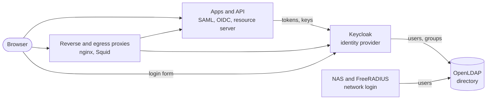

# identity-lab

[](https://codespaces.new/MarkHawk/identity-lab?quickstart=1)
[](https://github.com/MarkHawk/identity-lab/actions/workflows/ci.yml)

A Docker lab that reproduces real single sign-on and network login failures on demand: SAML, OIDC, LDAP, RADIUS, proxies and APIs. Each failure has a support runbook: the symptom, where to look, the fix and what to ask the customer. An automated test breaks every scenario, checks the user sees the right error, fixes it and proves the login works again.

**New here?** Read the [walkthrough](docs/walkthrough.md): real support tickets followed from the first message to the fix.

## How it fits together



Keycloak is the identity provider. It federates users from an OpenLDAP directory. SAML and OIDC apps and an API sit in front of it, some behind an nginx reverse proxy and one behind a Squid egress proxy. A NAS logs the same directory users in over RADIUS. The [full architecture](docs/architecture.md) shows every container, network and channel.

## 60-second tour

One scenario from start to finish: the SAML app's clock runs 10 minutes fast.

1. **Break it:** `scripts/break.sh clock-skew`. Only the app's container clock moves.
2. **See it:** in a private window, open `https://idlab.home:8181`, click **Log in with SAML** and sign in as alice. The app refuses: `Could not validate timestamp: expired. Check system clock.`
3. **Diagnose it:** [runbook 02](runbooks/02-clock-skew.md) says where to look. `date -u; docker compose exec saml-sp date -u` shows the two clocks 10 minutes apart.
4. **Fix it:** `scripts/fix.sh clock-skew`, then log in again. It works.
5. **Prove it:** `scripts/test.sh` does all of this for every scenario, with a real browser.

## Quick start

**Prerequisites:** Linux with Docker Engine and Compose v2, plus `bash`, `openssl`, `curl` and `jq`. It uses host ports 8180 to 8189.

```bash
git clone https://github.com/MarkHawk/identity-lab && cd identity-lab

scripts/setup.sh                 # CA, certificates and random secrets -> .env and certs/ (prints no secrets)
                                 # set LAB_HOST=localhost first if you have no DNS name for this machine
docker compose up -d --wait      # the whole lab; the first build takes 10 minutes or more (Squid is compiled from source)
scripts/pin-idp-cert.sh          # "onboard" the SAML app: trust the IdP's current signing certificate
scripts/status.sh                # service health and the live state of every scenario
docker compose exec nas nas-auth dave   # a RADIUS login from the NAS; enter the demo password -> "nas: Access-Accept"
```

Then [open the apps](docs/operating.md#open-the-apps-https-only) (HTTPS only, with a certificate warning to accept) and sign in as a [demo user](docs/operating.md#demo-users).

No Linux machine? [Run it in GitHub Codespaces](docs/codespaces.md), step by step.

## Scenarios

`scripts/break.sh <scenario>` breaks it, `scripts/fix.sh <scenario>` fixes it. The [scenario reference](docs/operating.md#scenario-reference) has what each one breaks and its exact log lines.

| # | Scenario | What the user sees | Runbook |
|---|---|---|---|
| 1 | `expired-signing-cert` | SAML app: `IdP signing certificate expired on <date>` | [01-expired-signing-cert](runbooks/01-expired-signing-cert.md) |
| 2 | `clock-skew` | SAML app: `Could not validate timestamp: expired. Check system clock.` | [02-clock-skew](runbooks/02-clock-skew.md) |
| 3 | `redirect-uri-mismatch` | Keycloak: `Invalid parameter: redirect_uri`, before the login form | [03-redirect-uri-mismatch](runbooks/03-redirect-uri-mismatch.md) |
| 4 | `ldap-bind-failure` | Keycloak, directory users only: `Unexpected error when handling authentication request to identity provider.` | [04-ldap-bind-failure](runbooks/04-ldap-bind-failure.md) |
| 5 | `radius-shared-secret-mismatch` | NAS: `RADIUS server not responding`. Web sign-in still works. | [05-radius-shared-secret-mismatch](runbooks/05-radius-shared-secret-mismatch.md) |
| 6 | `proxy-bad-gateway` | nginx: `502 Bad Gateway`. The app behind it is healthy. | [06-proxy-bad-gateway](runbooks/06-proxy-bad-gateway.md) |
| 7 | `proxy-gateway-timeout` | nginx: `504 Gateway Time-out`, 5 s after the password | [07-proxy-gateway-timeout](runbooks/07-proxy-gateway-timeout.md) |
| 8 | `proxy-rate-limit` | nginx: `429 Too Many Requests` when the password is submitted | [08-proxy-rate-limit](runbooks/08-proxy-rate-limit.md) |
| 9 | `proxy-forwarded-headers` | Keycloak: `Invalid Request`. OIDC logins post to port 443. | [09-proxy-forwarded-headers](runbooks/09-proxy-forwarded-headers.md) |
| 10 | `proxy-header-too-large` | nginx: `502 Bad Gateway` where the login page should be | [10-proxy-header-too-large](runbooks/10-proxy-header-too-large.md) |
| 11 | `proxy-auth-required` | App: `Tunnel connection failed: 407 Proxy Authentication Required` | [11-proxy-auth-required](runbooks/11-proxy-auth-required.md) |
| 12 | `proxy-policy-block` | App: `Tunnel connection failed: 403 Forbidden` | [12-proxy-policy-block](runbooks/12-proxy-policy-block.md) |
| 13 | `proxy-tls-interception` | App: `certificate verify failed: self-signed certificate in certificate chain` | [13-proxy-tls-interception](runbooks/13-proxy-tls-interception.md) |
| 14 | `proxy-bypass` | App: `Failed to resolve 'keycloak'`. The proxy logs nothing. | [14-proxy-bypass](runbooks/14-proxy-bypass.md) |
| 15 | `redirect-loop` | Browser: `ERR_TOO_MANY_REDIRECTS`, before any login | [15-redirect-loop](runbooks/15-redirect-loop.md) |
| 16a | `api-bearer-audience` | API: `401`, `invalid_token`: the audience doesn't include `idlab-api`. Login works. | [16-api-bearer-401](runbooks/16-api-bearer-401.md) |
| 16b | `api-bearer-expired` | API: `401`, `invalid_token`: the token expired, 10 s after login | [16-api-bearer-401](runbooks/16-api-bearer-401.md) |
| 17 | `proxy-maintenance` | Proxy: `Sign-in is down for planned maintenance` (503). Health checks stay green. | [17-service-unavailable](runbooks/17-service-unavailable.md) |
| 18a | `client-cert-missing` | Partner system: `400 Bad Request`, `No required SSL certificate was sent` | [18-client-cert](runbooks/18-client-cert.md) |
| 18b | `client-cert-expired` | Partner system: `400 Bad Request`, `The SSL certificate error` | [18-client-cert](runbooks/18-client-cert.md) |
| 19 | `cors-blocked` | Page: `Failed to fetch`; console: `blocked by CORS policy`. The API logs a 200. | [19-cors-blocked](runbooks/19-cors-blocked.md) |

## Go deeper

- [Walkthrough](docs/walkthrough.md): support tickets from first message to fix, with every tool.
- [Operating the lab](docs/operating.md): URLs, demo users, first logins, tests, rotating secrets, upgrading, troubleshooting.
- [Architecture](docs/architecture.md): the full diagram, each component and channel, and the repository layout.
- [Design decisions](docs/design-decisions.md): why it's built this way, and what testing against real software changed.
- [Known limitations](docs/limitations.md): what it doesn't do, or does differently from production.
- [Scenarios and the tools that help](docs/scenario-tools.md): which related tool helps with each scenario.
- [Codespaces guide](docs/codespaces.md) and [CHANGELOG](CHANGELOG.md).

## Related tools

- [token-inspector](https://github.com/MarkHawk/token-inspector): decodes a SAML response or JWT offline and explains what's wrong with it.
- [identity-support-splunk](https://github.com/MarkHawk/identity-support-splunk): a Splunk app that shows when a failure started, who is affected and the likely cause, with the runbook.
- [rate-limit-probe](https://github.com/MarkHawk/rate-limit-probe): tells whether a 429 is the client's fault or the API's.
- [auth-capture-explainer](https://github.com/MarkHawk/auth-capture-explainer): explains a RADIUS or LDAP packet capture offline.
- [triage-assistant](https://github.com/MarkHawk/triage-assistant): reads a ticket, finds the matching runbook and drafts the reply.

## How this was built

This project was built with AI-assisted tooling (Claude Code). I directed the scope, design and review. The assistant wrote much of the code and documentation, and every behaviour claimed here is checked by `scripts/test.sh`. Several design changes, such as the certificate pinning and the libfaketime monotonic-clock workaround, came from tests failing against the real software rather than from the first plan.

## License

[MIT](LICENSE)
