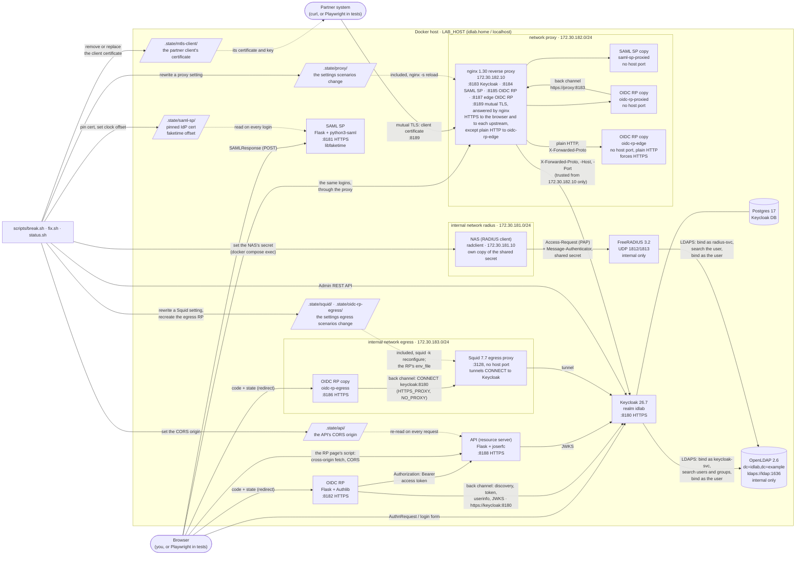

# Architecture

The full picture: every container, network and channel, and what the scenario scripts touch. The [README](../README.md) has a simpler version.

## Full diagram



## Components and channels

- **Front channel:** browsers reach everything at `https://$LAB_HOST:818x`. Keycloak issues tokens with the issuer for the port they used: `:8180` directly, `:8183` through the proxy.
- **Reverse proxy:** nginx publishes Keycloak and a second copy of each app on 8183–8185, so the whole login can go through it, as it would behind a real load balancer or ingress. It verifies each upstream's TLS certificate against the lab CA. It tells Keycloak the scheme and port the browser used in `X-Forwarded-*` headers, which Keycloak trusts only from the proxy's fixed address. The copies behind it have no host port of their own, and the proxied OIDC RP's back channel goes through the proxy too.
- **Egress proxy:** a third copy of the OIDC RP, `oidc-rp-egress` on `:8186`, sits on an internal network whose only way out is Squid, like an app server that must use a corporate forward proxy. Its back channel (discovery, token, userinfo, JWKS) goes to Squid as `CONNECT keycloak:8180`, set by `HTTPS_PROXY` and `NO_PROXY`, and Squid tunnels it. The browser side of its login doesn't use the proxy: the browser reaches the app on `:8186` and Keycloak directly on `:8180`. Squid publishes no host port.
- **Edge RP:** a fourth copy of the OIDC RP, `oidc-rp-edge`, sits behind the reverse proxy on `:8187` with TLS ending at the proxy and plain HTTP behind it, as behind most load balancers. It learns that the browser used HTTPS only from `X-Forwarded-Proto` (trusting one proxy hop), and redirects anything that looks like plain HTTP to its `https://` URL.
- **API:** a resource server on `:8188` that accepts Keycloak access tokens. The direct OIDC RP calls it with the user's access token (**Call the API** on its debug page), and the debug page's own script calls it from the browser too (**Call the API from the browser**), a cross-origin call under CORS. The API answers preflights for any origin, as a gateway in front of it often would, and puts its own `Access-Control-Allow-Origin` on real responses. It checks the token offline: the signature against Keycloak's JWKS, the issuer, the expiry and that `aud` includes `idlab-api`, which an audience mapper on the `oidc-rp` client adds. A failure gets a 401 with an RFC 6750 `WWW-Authenticate` header saying why.
- **Mutual TLS:** on `:8189` nginx accepts only clients that present a certificate from the lab CA, like a partner or device endpoint, and answers itself with what it verified. The partner system's certificate and key are in `.state/mtls-client/`; `scripts/test.sh` presents them from curl and Chromium.
- **Back channel:** the OIDC RP talks to Keycloak directly over the compose network at `https://keycloak:8180`, rewriting the token, userinfo and JWKS endpoints from discovery to that address (`OIDC_BACKCHANNEL_BASE`). The same images therefore work with `LAB_HOST=idlab.home` on a LAN and `LAB_HOST=localhost` in CI.
- **Directory:** Keycloak federates users from OpenLDAP (read only, imported on first login). It binds as a dedicated read-only service account, `cn=keycloak-svc`, to find users and their groups, then binds as the user to check the password. The directory has no host port; it's reachable only on the compose network.
- **RADIUS:** the NAS stands in for a switch, wireless controller or VPN gateway. It sends PAP Access-Requests to FreeRADIUS, which finds the user in the directory as its own read-only account, `cn=radius-svc`, and checks the password by binding as the user. So dave, erin and frank can log in over RADIUS as well as through Keycloak. RADIUS publishes no host port. The NAS sits on an internal network with a fixed IP, because the server identifies clients by source address.
- **SP trust:** the SAML SP doesn't fetch IdP metadata. Like most SaaS service providers, it trusts the IdP certificate pinned at onboarding (`scripts/pin-idp-cert.sh`).

## Repository layout

```
.devcontainer/               GitHub Codespaces / dev container: docker-in-docker, runs setup.sh on creation
compose.yaml                 Keycloak, Postgres, OpenLDAP, FreeRADIUS, NAS, saml-sp, oidc-rp, the API, the reverse
                             proxy and the apps behind it, Squid and the OIDC RP behind it, tests (profile "test")
keycloak/idlab-realm.json    realm, clients, demo users and LDAP federation; secrets injected via placeholders
ldap/                        OpenLDAP image: cn=config and directory seed LDIF, first-boot entrypoint
radius/                      FreeRADIUS image: minimal config, clients.conf, LDAP module, the one virtual server
nas/                         NAS image: first-boot secret seeding and nas-auth (one Access-Request)
apps/saml-sp/                Flask + python3-saml service provider
apps/oidc-rp/                Flask + Authlib relying party (also the edge copy, with plain HTTP and forced HTTPS)
apps/api/                    Flask + joserfc API (resource server) that accepts Keycloak access tokens
proxy/                       nginx.conf for the reverse proxy (with its mutual-TLS route), and defaults/ with
                             the healthy value of each setting the proxy scenarios change
squid/                       Squid image built from source, squid.conf, and defaults/ with the healthy value of
                             each setting the egress proxy scenarios change
scenarios/<name>.sh          detect / break / fix for each scenario
scripts/                     setup, pin-idp-cert, break, fix, status, test, lib
tests/                       Playwright image and e2e.py
runbooks/                    one support runbook per scenario
docs/codespaces.md           step-by-step guide to running the lab in GitHub Codespaces
docs/operating.md            URLs, demo users, first logins, tests, secrets, upgrading, troubleshooting
docs/architecture.md         this page: the full diagram, components and repository layout
docs/design-decisions.md     why the lab is built the way it is
docs/limitations.md          what it doesn't do, or does differently from production
docs/scenario-tools.md       which of the related tools helps with each scenario
docs/walkthrough.md          support tickets from first message to fix, using the lab and its tools
CHANGELOG.md                 what each phase added, and why upgrading needs setup.sh then test.sh --fresh
```
